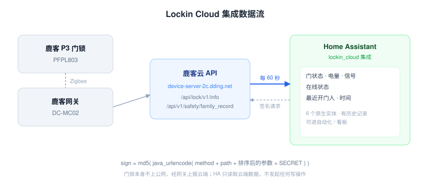

# Lockin Cloud for Home Assistant

[](https://github.com/hacs/integration)

把**鹿客（Lockin）智能门锁**接入 Home Assistant 的非官方集成。通过鹿客云 API 只读获取门状态、电量、在线状态、信号强度和最近一次开门记录。

> 本项目不是鹿客官方产品，与鹿客科技（Lockin）没有任何关联。它依赖从官方 App 逆向得到的私有 API，随时可能因服务端改动而失效。

---

## 免责声明

- 本项目**仅供个人学习与自用**，使用风险自负。
- 使用私有 API 可能违反鹿客的用户协议，理论上存在账号被限制的可能。
- 本项目**只读**，不提供开锁、上锁、改密码等任何写入操作。
- 请不要在 Issue、讨论区或任何公开场合粘贴你的 `access_token`。它等同于你家门的钥匙。

---

## 已验证设备

| 项目 | 值 |
|---|---|
| 门锁型号 | **鹿客 P3（PFPL803）** |
| 联网方式 | 鹿客网关 DC-MC02（Zigbee 转 Wi-Fi） |
| 测试环境 | Home Assistant 2026.10，Python 3.14 |
| 测试日期 | 2026-10 |

**仅在上述型号上实测通过。** 其他鹿客/云丁（dding）设备理论上可用——接口和签名是账号级的，不按型号区分——但没有实机验证。如果你的型号能用或不能，欢迎在 Issue 里反馈（附型号和错误码，不要附 token）。

---

## 提供的实体

| 实体 | 类型 | 说明 |
|---|---|---|
| `sensor.<设备名>_door_state` | 枚举 | 门状态：`open` / `closed` |
| `sensor.<设备名>_battery` | 电量 | 剩余电量百分比 |
| `sensor.<设备名>_signal` | 信号 | 网关信号质量（lqi） |
| `sensor.<设备名>_last_event` | 文本 | 最近一次开门的来源，如「指纹-张三」「临时密码」 |
| `sensor.<设备名>_last_event_time` | 时间戳 | 最近一次开门的时间 |
| `binary_sensor.<设备名>_online` | 连通性 | 门锁是否在线 |

`last_event` 还带有三个属性：`event_id`、`source`（开锁方式代码）、`occurred_at`（ISO 时间）。

数据每 **60 秒**轮询一次。

---

## 安装

### 方式一：HACS 自定义存储库（推荐）

1. 打开 HACS → 集成 → 右上角 `⋮` → **自定义存储库**
2. 仓库地址填 `https://github.com/YOURNAME/ha-lockin-cloud`
3. 类别选 **Integration**，点击添加
4. 在 HACS 里搜索 **Lockin Cloud** 并下载
5. **重启 Home Assistant**

### 方式二：手动安装

把 `custom_components/lockin_cloud` 整个目录复制到你的 HA 配置目录下的 `custom_components/`，然后重启 HA。

```
<config>/
└── custom_components/
    └── lockin_cloud/
        ├── __init__.py
        ├── api.py
        ├── binary_sensor.py
        ├── config_flow.py
        ├── const.py
        ├── coordinator.py
        ├── manifest.json
        ├── sensor.py
        └── translations/
```

---

## 配置

集成需要你从鹿客 App 里取出一个 `access_token`。这一步只需要做一次。

### 1. 抓取 access_token

1. 在手机上准备一个 HTTPS 抓包工具：iOS 可用 **Stream**、**Thor**，Android 可用 **HttpCanary**，或电脑上的 **Charles** / **mitmproxy**
2. 安装并信任抓包工具的根证书
3. 打开**鹿客 App**，进入门锁详情页，下拉刷新一次
4. 在抓包记录里找到域名 **`device-server-2c.dding.net`** 的任意请求
5. 查看请求的 URL，里面有一个参数 `access_token=`
6. 把 `access_token` 的**完整值**复制出来（很长，形如 `a1b2c3d4e5f60718293a4b5c6d7e8f90:0123456789abcdef...`，含中间的英文冒号）

> 这个 token 是 30 天滑动有效期：服务端每次响应都会把它延长，集成持续轮询时它不会过期。只有 HA 连续停机超过 30 天、你修改了鹿客密码、或主动在 App 里退出登录，才需要重新抓取。

### 2. 在 Home Assistant 中添加

1. 设置 → 设备与服务 → **添加集成**
2. 搜索 **Lockin Cloud**
3. 粘贴 `access_token`，提交
4. 账号下有多把锁时，会让你选择要添加哪一把
5. 完成后会出现「设备名」设备和 6 个实体

---

## 自动化示例

门开着超过 2 分钟就推送提醒：

```yaml
automation:
  - alias: 门没关好
    triggers:
      - trigger: state
        entity_id: sensor.da_men_door_state
        to: "open"
        for: "00:02:00"
    actions:
      - action: notify.mobile_app_your_phone
        data:
          title: 门没关
          message: 门已经开了 2 分钟还没有关上
```

有人开门时通知：

```yaml
automation:
  - alias: 有人开门
    triggers:
      - trigger: state
        entity_id: sensor.da_men_last_event_time
    actions:
      - action: notify.mobile_app_your_phone
        data:
          message: >-
            {{ state_attr('sensor.da_men_last_event', 'occurred_at') }}
            由 {{ states('sensor.da_men_last_event') }} 开门
```

---

## 工作原理



```
HA (Lockin Cloud 集成)
   │  每 60 秒
   ├── GET https://device-server-2c.dding.net/api/lock/v1/info?uuid=<门锁>
   │      → 门状态 / 电量 / 在线 / 信号
   └── GET https://device-server-2c.dding.net/api/v1/safety/family_record
          → 最近开门记录（谁 / 什么时候 / 什么方式）
```

请求需要签名，签名算法从 Android 客户端逆向得到：

```
sign = md5( java_urlencode( (method + path).lower()
                            + "k1=v1&k2=v2&..."   # 参数按 key 升序，不含 sign 本身
                            + SIGN_SECRET ) )
```

详见 `custom_components/lockin_cloud/api.py`。

---

## 已知限制

- **只读**：不支持远程开锁、上锁、改密码、发临时密码。
- **延迟**：轮询周期 60 秒，门状态变化最多晚 60 秒反映到 HA。想更快可以把 `const.py` 里的 `DEFAULT_SCAN_INTERVAL` 改小，但不建议低于 30 秒，避免触发风控。
- **依赖云**：断网、鹿客服务器故障、门锁离线，实体都会变成 `unavailable`。
- **token 需要手动获取**：没有实现账号密码登录，因为那需要处理短信验证码和图形验证码。

---

## 故障排查

| 现象 | 原因 | 处理 |
|---|---|---|
| 添加时提示「无法访问鹿客云」 | token 过期或复制不完整 | 重新抓一次 token，注意不要漏掉中间的冒号 |
| 实体变成 `unavailable` | HA 到 `device-server-2c.dding.net` 不通 | 检查 HA 容器能否解析并访问该域名 |
| 门状态一直不变化 | 门锁离线 | 看 `binary_sensor.*_online`；检查网关和电池 |
| 最近事件一直是旧的 | 该账号很久没人开门 | 正常现象 |

查看日志：设置 → 系统 → 日志，搜索 `lockin_cloud`。

---

## 贡献

欢迎提交 Issue 和 PR。提交前请确认：

- 不要包含任何真实的 token、设备 SN、MAC、家庭住址或成员姓名
- 附上 HA 版本、门锁型号、完整错误码（`ErrNo`）

---

## License

[MIT](LICENSE)
